# Diagrama de clases (PlantUML)

Todo el programa en un solo diagrama. Se puede pegar tal cual en
[plantuml.com/plantuml](https://www.plantuml.com/plantuml/uml) o en la extensión
de VS Code *PlantUML* (previsualizar con `Alt+D`).

Notación: `+` público, `-` privado (todo lo que empieza por `_` en GDScript),
`{static}` para los `static func`, `«signal»` para las señales de Godot.

```plantuml
@startuml
skinparam shadowing false
skinparam classAttributeIconSize 0
skinparam classFontStyle bold
skinparam nodesep 40

title ProxectoEco — diagrama de clases (scripts/*.gd)

legend right
  |= Fichero |= Clase |
  | scripts/dtl_mapa.gd | DTLMapa |
  | scripts/dtl_tileset.gd | DTLTileSet |
  | scripts/bloque.gd | Bloque |
  | scripts/echo.gd | Echo |
  | scripts/senales_tiles.gd | SenalesTiles |
  | scripts/character_body_2d.gd | Personaje (sin class_name) |
  | scripts/enemigo.gd | Enemigo |
  | scripts/pasillo.gd | Pasillo (sin class_name) |
  | scripts/llave.gd | Llave |
  | scripts/puerta.gd | Puerta |
  | scripts/objetivo.gd | Objetivo |
  | scripts/mapa_colocacion.gd | MapaColocacion |
end legend

' ============ Mapa procedural ============

package "Mapa procedural" {

  enum Generador {
    ROGUELIKE
    ROGUELIKE_SIMPLE
    MAZE_DIG
    MAZE_BAR
    CLUSTERING_MAZE
    CELLULAR
    CELLULAR_MIX
    VORONOI
    PERLIN
    PERLIN_LOOP
    PERLIN_SOLITARIO
    FRACTAL
    FRACTAL_LOOP
    DIAMOND_SQUARE
    DIAMOND_SQUARE_CORNER
  }

  enum Tipo {
    VACIO
    MURO
    SUELO
    UMBRAL
  }

  class DTLMapa <<Node2D>> {
    «signal» generar_terminada(dimensiones: Vector2i)
    --
    +tile_set : TileSet
    +generador : Generador
    +ancho : int
    +alto : int
    +semilla_aleatoria : bool
    +semilla : int
    +marco : bool
    +grosor_marco : int
    +engrosar : int
    +duracion_chocado_muro : float
    +proporcion_sensibles : float
    +color_sensible : Color
    +pasillo_max : int
    +proporcion_pasillo_ancho : float
    +tile : int
    +pintar : bool
    +colision_muros : bool
    +capa_colision : int
    +mascara_colision : int
    +generar_navegacion : bool
    +nombre_region : StringName
    +celda_navegacion : int
    +cuerpo_nav : float
    +resolucion_nav : int
    +depurar : bool
    --
    +generar(nueva_semilla: bool = true)
    +punto_inicial() : Vector2
    +dimensiones() : Vector2i
    +es_transitable(celda: Vector2i) : bool
    +es_muro(celda: Vector2i) : bool
    +es_sala(celda: Vector2i, holgura: int) : bool
    +centro_celda(celda: Vector2i) : Vector2
    +celda_de(punto: Vector2) : Vector2i
    +bloques() : Array[Bloque]
    +bloques_sensibles() : Array[Bloque]
    +bloque_en(punto: Vector2) : Bloque
    +es_navegable(punto: Vector2) : bool
    +celda_navegable(celda: Vector2i) : bool
    +celda_sala_cerca(desde: Vector2i, radio: int, minimo: int) : Vector2i
    +probar_navegacion(desde: Vector2, hasta: Vector2) : bool
    --
    -_enter_tree()
    -_llamar_dtl() : Array
    -_normalizar(datos: Array) : Array[Array]
    -_desde_binario(datos: Array) : Array[Array]
    -_desde_altura(datos: Array) : Array[Array]
    -_recortar()
    -_poner_marco(grosor: int)
    -_engrosar_suelo(radio: int)
    -_ensanchar_pasillos(ancho_max: int)
    -_grupos_de_pasillo() : Array
    -_inundar(inicio: Vector2i, visto: Dictionary, solo_estrechas: bool) : Array
    -_particionar(tipo: int) : Array[Rect2i]
    -_limpiar()
    -_construir_tilemap()
    -_construir_colision()
    -_es_sensible(r: Rect2i) : bool
    -_construir_malla()
    -_construir_navegacion()
    -_construir_navegacion_erosionada()
    -_cabe_cuerpo(centro: Vector2, medio: float) : bool
    -_primera_region() : NavigationRegion2D
    -_fila_atlas(tipo: int) : int
    -_imprimir_resumen()
    --
    -_rejilla : Array[Array]
    -_datos : Array
    -_tiles_generados : TileMapLayer
    -_bloques : Array[Bloque]
    -_regiones : Array[NavigationRegion2D]
    -_nav : PackedByteArray
  }

  class DTLTileSet <<RefCounted, static>> {
    +COLUMNAS : int {static} = 4
    +FILAS : int {static} = 3
    +SUELO : int {static} = 0
    +MURO : int {static} = 1
    +UMBRAL : int {static} = 2
    --
    +crear(tile_size: int, semilla: int) : TileSet {static}
    +crear_textura(tile_size: int, semilla: int) : ImageTexture {static}
    +indice_para(fila: int, variante: int) : Vector2i {static}
    --
    -_pintar_tesela(img, origen, tile_size, base, rng, con_volumen) {static}
  }

  class Bloque <<StaticBody2D>> {
    «signal» impactado(duracion: float)
    --
    +CAPA_MURO : int {static} = 8
    +CAPA_PERSONAJE : int {static} = 1
    +duracion_chocado : float
    +color_muro : Color
    +color_chocado : Color
    +sensible : bool
    +color_chocado_sensible : Color
    +intensidad_chocado : float
    +chocado : bool
    --
    +chocar()
    +tiempo_restante() : float
    --
    -_ready()
    -_process(delta: float)
    -_apagar()
    -_draw()
    -_color_actual() : Color
    -_restante : float
  }
}

' ============ Ondas y rastreo ============

package "Ondas (ecolocalización)" {

  class Echo <<Node2D>> {
    +AREA_GROUP : String {static} = "echo_onda"
    +FUENTE_GROUP : String {static} = "eco_fuente"
    +CAPA_ONDA_JUGADORA : int {static} = 2
    +CAPA_ONDA_ENEMIGA : int {static} = 4
    +CAPA_MURO : int {static} = Bloque.CAPA_MURO
    --
    +max_radius : float
    +duration : float
    +ring_count : int
    +ring_delay : float
    +color_wave : Color
    +line_width : float
    +angulo : float
    +capa : int
    +capas_muro : int
    +tramos : int
    +muestras : int
    +recortada : bool
    +bloques_tocados : Array[Bloque]
    --
    +ha_tocado_muros() : bool
    +radio_actual() : float
    +radio_maximo_alcanzado() : float
    +radio_en_direccion(angulo_local: float) : float
    +radios() : PackedFloat32Array
    +alcanza(punto: Vector2) : bool
    +alcanza_local(lx: float, ly: float) : bool
    +refrescar_recorte()
    --
    -_ready()
    -_process(delta: float)
    -_physics_process(_delta: float)
    -_build_wave_area()
    -_recortar()
    -_rayo(espacio, origen, a) : float
    -_choque(espacio, origen, ...) : float
    -_angulo_tramo(i: int, medio: float) : float
    -_draw()
    -_borde(alcance: float) : PackedVector2Array
    -_forma_sector(alcance: float) : PackedVector2Array
    -_arco(radius: float, segmentos: int) : PackedVector2Array
    -_arco_tramo(i: int, alcance: float) : PackedVector2Array
    -_radio_tramo(i: int, alcance: float) : float
    -_current_radius(offset: float) : float
    -_ease_out(t: float) : float
    -_total_lifetime() : float
    --
    -_elapsed : float
    -_wave_area : Area2D
    -_distancias : PackedFloat32Array
    -_recortado : bool
  }

  class SenalesTiles <<Node2D>> {
    «signal» celda_marcada(celda: Vector2i)
    «signal» mapa_revelado
    --
    +capas_onda : int
    +nodo_mapa : NodePath
    --
    +senal_de(celda: Vector2i) : bool
    +celdas_con_senal() : Array[Vector2i]
    +quedan_por_revelar() : int
    +revelado() : bool
    +reiniciar()
    --
    -_ready()
    -_process(_delta: float)
    -_marcar_cono(onda: Echo)
    -_marcar_celda(celda: Vector2i)
    -_estrechar_recta(p: float, q: float, rango: Vector2i) : Vector2i
    -_reservar(_dimensiones: Vector2i)
    -_dentro(celda: Vector2i) : bool
    --
    -_mapa : DTLMapa
    -_bandas : PackedByteArray
    -_ancho : int
    -_alto : int
    -_quedan : int
    -_revelado : bool
  }

  class Pasillo <<Area2D, sin class_name>> {
    +umbral : float
    +color_activado : Color
    +detectado : bool
    --
    +detectar_onda(onda: Echo) : bool
    --
    -_ready()
    -_process(_delta: float)
    -_on_area_entered(area: Area2D)
    -_set_detectado(valor: bool)
    -_estado() : String
    -_pintar(activado: bool)
    --
    -_onda : Echo
  }
}

' ============ Personajes ============

package "Personajes" {

  class Personaje <<CharacterBody2D, sin class_name, character_body_2d.gd>> {
    +SPEED : float {static} = 250.0
    +Ecolocalización : PackedScene {static} = echo.tscn
    --
    +wave_max_radius : float
    +wave_duration : float
    +wave_cooldown : float
    +ralentizacion_segundos : float
    +factor_ralentizacion : float
    +alerta_enfriamiento : float
    +margen_alerta : float
    +encender_al_chocar : bool
    +tiene_llave : bool
    +cooldown : Timer
    --
    +emitir_onda()
    --
    -_ready()
    -_physics_process(delta: float)
    -_unhandled_input(event: InputEvent)
    -_gastar_efectos(delta: float)
    -_chocar_con_sensibles()
    -_alertar_enemigo(punto: Vector2)
    -_on_onda_entrada(area: Area2D)
    --
    -_ralentizada : float
    -_alerta_enfriamiento : float
    -_oido : Area2D
  }

  class Enemigo <<CharacterBody2D>> {
    +GRUPO : StringName {static} = "enemigo"
    +Ecolocalización : PackedScene {static} = echo.tscn
    --
    +velocidad_max : float
    +aceleracion : float
    +frenado : float
    +llegada : float
    +pausa_min : float
    +pausa_max : float
    +margen : float
    +onda_max_radius : float
    +onda_duration : float
    +onda_intervalo : float
    +distancia_carga : float
    +memoria_segundos : float
    +radio_busqueda : int
    +alerta_segundos : float
    +sin_avance_max : float
    +desatasque_tiempo : float
    +paso_rodeo : float
    +ajuste_malla : float
    +capas_muro : int
    +intervalo_caceria : float
    +radio_caceria : int
    +radio_caceria_min : int
    +nodo_jugadora : NodePath
    +nodo_mapa : NodePath
    --
    +alertar(punto: Vector2)
    --
    -_ready()
    -_physics_process(delta: float)
    -_on_onda_entrada(area: Area2D)
    -_on_onda_salida(area: Area2D)
    -_oír_ondas()
    -_llega_el_sonido(onda: Echo) : bool
    -_gastar_memoria(delta: float)
    -_cargando() : bool
    -_moverse(delta: float)
    -_ir_a(punto: Vector2, delta: float)
    -_waypoint(meta: Vector2) : Vector2
    -_destino_libre(siguiente: Vector2) : Vector2
    -_via_libre(desde: Vector2, hasta: Vector2) : bool
    -_cuerpo_libre(punto: Vector2) : bool
    -_preparar_sonda()
    -_en_malla(punto: Vector2) : Vector2
    -_frenar(delta: float)
    -_lanzar_onda(delta: float)
    -_contar_caceria(delta: float)
    -_cazar()
    -_celda_sala_cerca(centro: Vector2) : Vector2i
    -_aparecer(destino: Vector2)
    -_punto_aleatorio() : Vector2
    -_punto_cerca(centro: Vector2, celdas: int) : Vector2
    -_punto_en(area: Rect2) : Vector2
    -_recordar_bloqueo()
    -_vigilar_atasco(delta: float)
    -_desatascar()
    -_rodear_muro()
    -_retroceder()
    -_esquivar()
    -_dir_bloqueo() : Vector2
    -_en_el_final_de_la_ruta() : bool
    -_medio_cuerpo() : float
    --
    -_destino : Vector2
    -_pausa : float
    -_espera_onda : float
    -_memoria : float
    -_ultima_onda_pos : Vector2
    -_alerta : bool
    -_alerta_restante : float
    -_ondas_oido : Array
    -_barriendo : bool
    -_destino_barrido : Vector2
    -_caceria : float
    -_nivel_atasco : int
    -_sin_avance : float
    -_jugadora : Node2D
    -_mapa : DTLMapa
    -_oido : Area2D
    -_agente : NavigationAgent2D
  }
}

' ============ Objetos de nivel ============

package "Objetos de nivel" {

  class Llave <<Area2D>> {
    «signal» recogida(posicion: Vector2)
    --
    +nodo_jugadora : NodePath
    +celda : Vector2i
    --
    +esta_recogida() : bool
    +reponer()
    --
    -_ready()
    -_on_cuerpo_entered(cuerpo: Node2D)
    -_comprobar_solape()
    -_recoger_si_es(cuerpo: Node2D)
    -_jugadora() : Node2D
    --
    -_recogida : bool
  }

  class Puerta <<Area2D>> {
    «signal» victoria(celda: Vector2i)
    «signal» abierta(celda: Vector2i)
    «signal» rechazada(celda: Vector2i)
    --
    +nodo_jugadora : NodePath
    +celda : Vector2i
    +color_cerrada : Color
    +color_abierta : Color
    +texto_sin_llave : String
    --
    +esta_abierta() : bool
    +reponer()
    --
    -_ready()
    -_on_cuerpo_entered(cuerpo: Node2D)
    -_jugadora() : Node2D
    -_pintar()
    --
    -_abierta : bool
  }

  class Objetivo <<Node>> {
    +mapa : NodePath
    +nodo_llave : NodePath
    +nodo_puerta : NodePath
    +nodo_jugadora : NodePath
    +distancia_minima_salida : int
    +distancia_minima_llave : int
    --
    +colocar()
    --
    -_ready()
    -_al_regenerar(_dimensiones: Vector2i)
    -_celda_de_la_jugadora(mapa: DTLMapa) : Vector2i
    -_celda_mas_lejana(mapa: DTLMapa, pasos: Dictionary) : Vector2i
    -_celda_callejon_opuesto(mapa, pasos_desde, ...) : Vector2i
    -_es_callejon(mapa: DTLMapa, celda: Vector2i) : bool
    -_pasos_desde(mapa: DTLMapa, inicio: Vector2i) : Dictionary
    -_al_borde(celda: Vector2i, d: Vector2i) : int
  }

  class MapaColocacion <<Node>> {
    +mapa : NodePath
    +nodos : Array[NodePath]
    +celda_preferida : Vector2i
    +separacion : float
    +holgura : int
    --
    -_ready()
    -_sitio(mapa: DTLMapa, region: Dictionary, ocupadas: Array[Vector2]) : Vector2i
    -_mejor_celda(mapa: DTLMapa, region: Dictionary, margen: int, ...) : Vector2i
    -_libre_alrededor(mapa: DTLMapa, celda: Vector2i, margen: int) : bool
    -_componente_mayor(mapa: DTLMapa) : Dictionary
    -_inundar(mapa: DTLMapa, inicio: Vector2i, visitadas: Dictionary) : Dictionary
  }
}

' ============ Relaciones ============

DTLMapa "1" *-- "0..*" Bloque : crea en _construir_colision()
DTLMapa --> DTLTileSet : pinta con {static}
DTLMapa ..> Tipo : rejilla

Personaje ..> Echo : instancia echo.tscn y la lanza
Enemigo ..> Echo : ondas de sondeo
Echo ..> Bloque : rayos del recorte -> chocar()
SenalesTiles ..> Echo : grupo eco_fuente, alcanza_local()
SenalesTiles --> DTLMapa : nodo_mapa, generar_terminada

Personaje ..> Enemigo : alertar() por el grupo "enemigo"
Personaje --> Bloque : get_slide_collision()
Enemigo --> DTLMapa : navegación y celdas
Enemigo --> Personaje : nodo_jugadora (seguir)

Pasillo ..> Echo : detectar_onda()
Llave --> Personaje : escribe tiene_llave
Puerta --> Personaje : lee tiene_llave

Objetivo --> DTLMapa : eliges suelo en generar_terminada
Objetivo --> Llave : colocar()
Objetivo --> Puerta : colocar()
Objetivo --> Personaje : nodo_jugadora (distancias)
MapaColocacion --> DTLMapa : reparte nodos por celdas

note bottom of Personaje
  Personaje y Pasillo no llevan class_name: se nombran aquí
  por lo que son. Fichero: character_body_2d.gd y pasillo.gd.
end note

note top of Enemigo
  Estados internos (no son miembros): Paseo, Carga, Barrido,
  Alerta y Aparicion. Los decide _moverse() en este orden:
  _cargando() -> _pausa -> paseo. El desatasque vive dentro
  de _ir_a() via _nivel_atasco.
end note

note bottom of DTLMapa
  Los parámetros de generación (RogueLike, autómata, Voronoi,
  Perlin, fractal, relieve) se omiten por cantidad; todos son
  @export y viven en dtl_mapa.gd bajo @export_group.
end note

@enduml
```

## Índice de relaciones

| Relación | Por dónde va |
| --- | --- |
| `DTLMapa` → `Bloque` | `_construir_colision()` crea un `Bloque` por rectángulo de muro; la consulta pública es `bloques()`, `bloques_sensibles()` y `bloque_en()`. |
| `DTLMapa` → `DTLTileSet` | Si `tile_set` es null, `generar()` llama a `DTLTileSet.crear(tile, semilla)`. |
| `Personaje`/`Enemigo` → `Echo` | `emitir_onda()` y `_lanzar_onda()` instancian `scenes/echo.tscn`, le ponen `capa`, `max_radius` y `duration` y apuntan con `rotation` al ratón o al punto oído. |
| `Echo` → `Bloque` | `_recortar()` lanza `tramos × muestras` rayos contra `CAPA_MURO`, guarda los tocados en `bloques_tocados` y les llama `chocar()`. |
| `SenalesTiles` → `Echo` | Sin referencia: `_process` recorre el grupo `eco_fuente` y pregunta `alcanza_local()` fila a fila. |
| `Personaje` → `Enemigo` | `_alertar_enemigo()` recorre el grupo `Enemigo.GRUPO` y llama `alertar(punto)`, sin guardar referencias. |
| `Llave`/`Puerta` → `Personaje` | El estado viaja en la jugadora: `Llave` escribe `tiene_llave`, `Puerta` lo lee para decidir `victoria`. |
| `Objetivo` | Se conecta a `generar_terminada` y al recolocar elige celda de salida (`_celda_mas_lejana`) y de llave (`_celda_callejon_opuesto`). |
