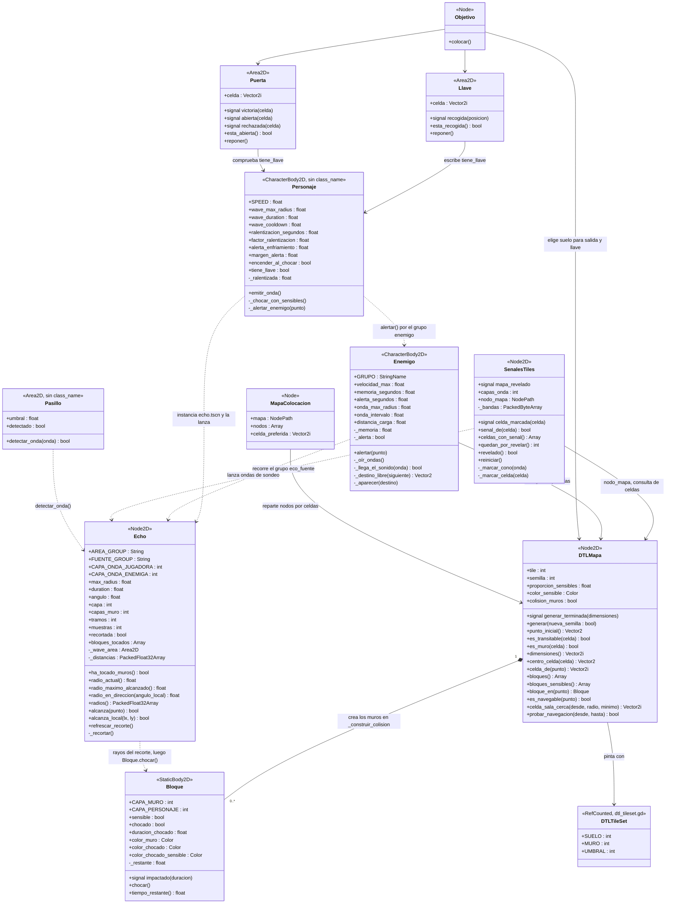
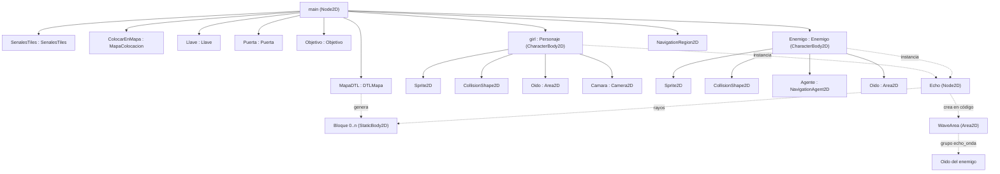
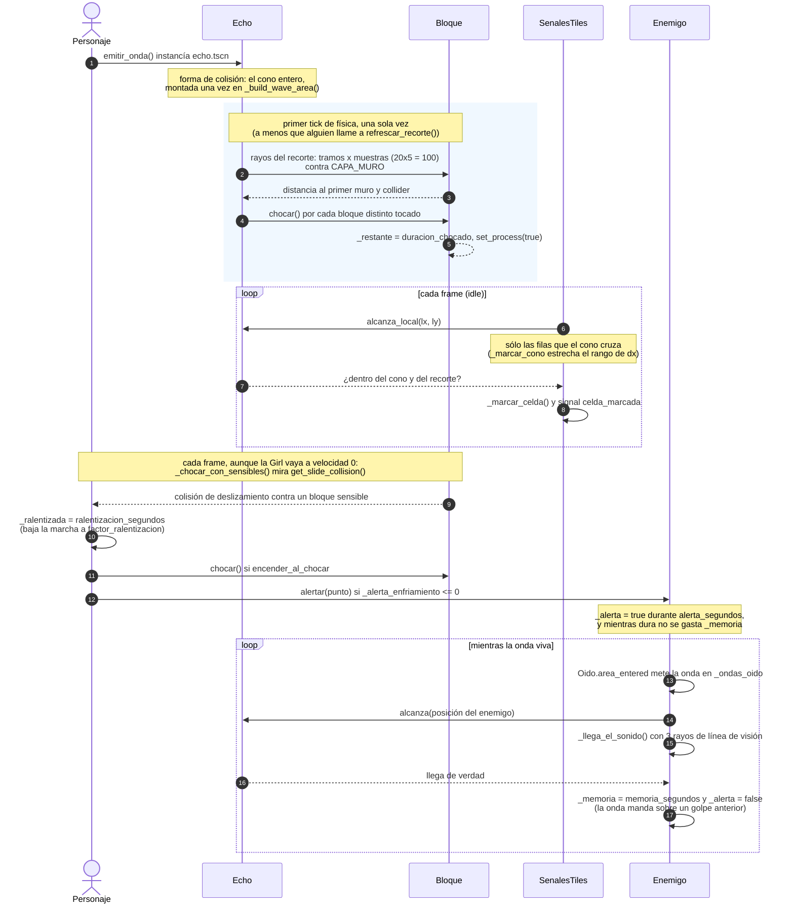
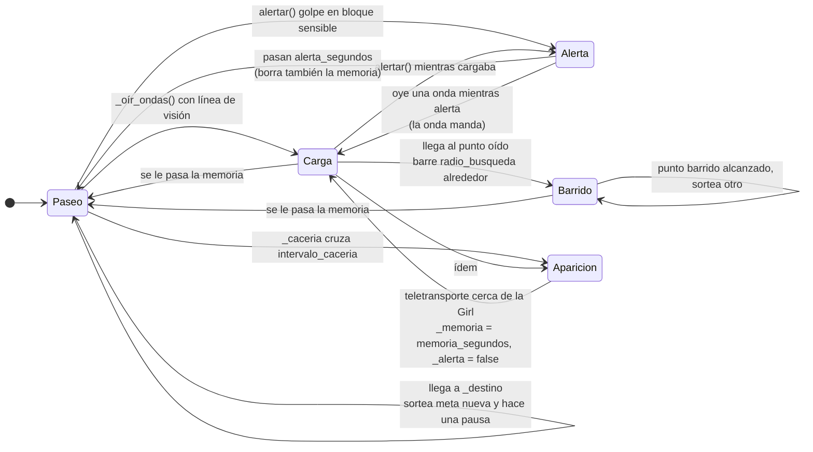

# Diagramas UML

Fuente en [Mermaid](https://mermaid.js.org/): GitHub la renderiza solo al ver el
fichero, y si no se puede usar [mermaid.live](https://mermaid.live) o la extensión
de VS Code con un previsualizador de Mermaid.

- [Diagrama de clases](#diagrama-de-clases)
- [Árbol de escena](#árbol-de-escena)
- [Onda: recorte, marcado y alerta](#onda-recorte-marcado-y-alerta)
- [Estados del enemigo](#estados-del-enemigo)

## Diagrama de clases

Sólo la API pública y el estado que importa; lo privado se agrupa en el diagrama
de secuencia o se omite. `Personaje` y `Pasillo` no llevan `class_name`, se
nombran aquí por lo que son.

### Notas de las relaciones

| Relación | Por dónde va |
| --- | --- |
| `DTLMapa` → `Bloque` | `_construir_colision()` crea un `Bloque` por rectángulo de muro; `bloques()`, `bloques_sensibles()` y `bloque_en()` son la consulta pública. |
| `Echo` → `Bloque` | `_recortar()` lanza los rayos contra `Bloque.CAPA_MURO`, guarda los tocados en `bloques_tocados` y les llama `chocar()`. |
| `Personaje` → `Enemigo` | `_alertar_enemigo()` no guarda referencia: recorre el grupo `Enemigo.GRUPO` y llama `alertar(punto)`. |
| `SenalesTiles` → `Echo` | No hay referencia directa: `_process` recorre el grupo `Echo.FUENTE_GROUP` y le pregunta con `alcanza_local()`. |
| Señales sin consumidor | `celda_marcada`, `mapa_revelado`, `impactado`, `recogida`, `victoria`, `abierta` y `rechazada` están declaradas pero ninguna las conecta en la escena actual; sí se consumen `generar_terminada` (`Objetivo`, `SenalesTiles`) y `area_entered` de los `Oido`. |

## Árbol de escena

`scenes/main.tscn`, con los scripts que lleva cada nodo:

Capas de colisión (una por script, para que el filtrado lo haga la física):

| Bit | Capa | Quién la usa |
| --- | --- | --- |
| 0 | `Bloque.CAPA_PERSONAJE` | `girl`, `Enemigo` |
| 1 | `Echo.CAPA_ONDA_JUGADORA` | ondas de la Girl, las oye el `Oido` del enemigo |
| 2 | `Echo.CAPA_ONDA_ENEMIGA` | ondas del enemigo, las oye el `Oido` de la Girl |
| 3 | `Bloque.CAPA_MURO` | muros; máscara de los rayos de `Echo` |

En `main.tscn` los `Oido` tienen la máscara a 0: cada script se la pone en
`_ready` (`character_body_2d.gd` con `CAPA_ONDA_ENEMIGA`, `enemigo.gd` con
`CAPA_ONDA_JUGADORA`), así que el filtrado vive en el código y no en la escena.

## Onda: recorte, marcado y alerta

El ciclo completo de una onda de la Girl, con el momento exacto en que cada cosa
se calcula (el recorte es una sola vez, el marcado es cada frame):

## Estados del enemigo

`_moverse()` decide en este orden:

1. **`_cargando()`** — `true` si hay alerta (esa va siempre, sin comprobar
   distancia) o si `_memoria > 0` y el punto oído está a menos de
   `distancia_carga`. Va a `_ultima_onda_pos`; al llegar (`<= llegada`) entra en
   **Barrido** en vez de quedarse clavado.
2. **`_pausa`** — se para entre destinos.
3. **Paseo** — si ya está en `_destino`, sortea otra meta; si no, `_ir_a()`
   con `_destino_libre()` encima.

El **desatasque** no es un estado aparte: vive dentro de `_ir_a()`. Si
`_sin_avance` crece, sube `_nivel_atasco` y en cada escalón hace una cosa —
`_rodear_muro()` (elige lado del muro, `_borde_t`), `_retroceder()` (`_fuga_t`,
va para atrás sin ruta) y `_esquivar()` (punto cercano; si no hay ninguno se
rinde: borra memoria y alerta y sortea meta nueva).

La alerta tiene reloj propio (`_gastar_memoria()`): mientras dura, la memoria de
la onda no se gasta, porque el sonido se atenúa con la distancia y el golpe no.
